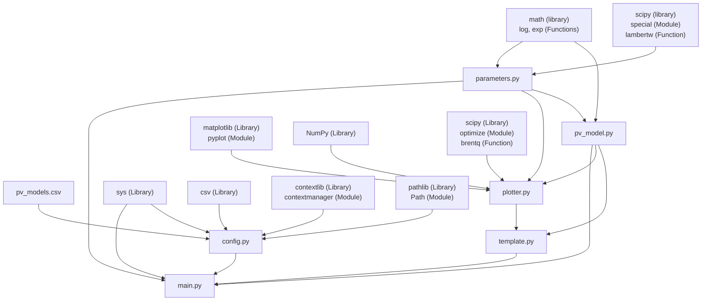
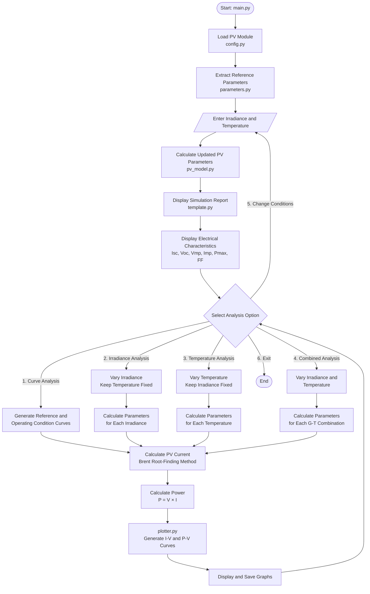

# Solar PV I-V Characteristics Graph Project

# 1. Project Title and Overview

## **Project Name:** Solar PV Simulator

## *Project Overview*

**Solar PV Simulator** is a Python-based application that simulates the electrical characteristics of photovoltaic (PV) modules using the Single-Diode Model. It calculates PV parameters and generates I–V and P–V curves to analyze how changes in solar irradiance and temperature affect module performance.

### **Key Functional &amp; Architectural Highlights** 
1\. **Theoretical Modeling Foundation** 
* Built upon the **Single Diode Equivalent Circuit Model**, incorporating parameters such as light-generated current ($I_L$), diode reverse saturation current ($I_0$), series resistance ($R_s$), shunt resistance ($R_{sh}$), and diode ideality factor ($n$). 
* Integrates standard PV performance formulations, including the **De Soto Five-Parameter Model**  contributed via the PV Performance Modeling Collaborative (PVPMC by NIST and Sandia National Laboratories).
* Models the complete non-linear governing single-diode equation: $$I = I_L - I_0 \left[ \exp\left( \frac{V + I R_s}{n N_s V_T} \right) - 1 \right] - \frac{V + I R_s}{R_{sh}}$$

2\. **Modular Software Architecture**

The simulator is split into small files. Each file has one job.

* **`main.py`**: The starting point. It asks the user to choose a PV module and enter irradiance and temperature. It then calls the other files in order and shows the analysis menu (curves, irradiance analysis, temperature analysis, combined analysis, change condition, exit).
* **`config.py`**: Loads the datasheet values (V_oc, I_sc, V_mp, I_mp, P_max, number of cells N_s, and the temperature coefficients for I_sc, V_oc and P_max) for the chosen module from the `pv_models.csv` catalogue. It also checks that the file is valid.
* **`pv_models.csv`**: The catalogue of PV modules. Adding a new row adds a new module, with no code changes needed.
* **`parameters.py`**: Uses the datasheet values at standard test conditions to find the hidden single-diode parameters: I_L, I_0, R_s, R_sh and the ideality factor n. It uses the Batzelis datasheet method, which relies on the Lambert W function.
* **`pv_model.py`**: The calculation engine. It adjusts the parameters to the user's irradiance and temperature, then calculates I_sc, V_oc, V_mp, I_mp and P_max for those conditions.
* **`plotter.py`**: Solves the single-diode equation for each voltage point and draws the I-V and P-V curves. It also draws the comparison plots for different irradiances, temperatures, or both together. All plots are saved as PNG images.
* **`template.py`**: Controls what is printed on screen: the simulation report, the menu, and the result tables for each analysis. It calls `plotter.py` to draw the graphs.

**How the files work together**

`main.py` → `config.py` (load module) → `parameters.py` (reference parameters) → `pv_model.py` (results for the chosen conditions) → `template.py` (print results) → `plotter.py` (draw graphs)

3\. **Numerical Solvers & Analysis**

This part of the project solves the single-diode equation and uses the results to study how a PV module behaves.

* **Solving the equation:** The single-diode equation is implicit, because the current I appears on both sides. The code finds current for each voltage point using **Brent's method** (`scipy.optimize.brentq`) in `plotter.py`. The **Lambert W function** (`scipy.special.lambertw`) is used in `parameters.py` to extract the reference parameters (I_L, I_0, R_s, R_sh, n) from the datasheet values.
* **Performance results:** For any irradiance and temperature, the simulator reports Short-Circuit Current (I_sc), Open-Circuit Voltage (V_oc), Maximum Power Voltage (V_mp), Maximum Power Current (I_mp), Maximum Power (P_max), and Fill Factor (FF).
* **Environmental effects:** The simulator studies how conditions change the output:
  * **Irradiance analysis:** several irradiance values (W/m²) at a fixed temperature of 25 °C.
  * **Temperature analysis:** several temperatures (°C) at a fixed irradiance of 1000 W/m².
  * **Combined analysis:** I-V and P-V curves for different irradiance and temperature pairs.
* **Temperature coefficients:** I_sc increases slightly with temperature, while V_oc and P_max decrease. These are applied using the coefficients stored in `pv_models.csv`.
---

## Table of Contents
1. [Project Title and Overview](#1-project-title-and-overview)
2. [Features](#2-features)
3. [Complete Process Theory of Photovoltaic Systems](#3-complete-process-theory-of-photovoltaic-systems)
4. [Architecture Diagram](#4-architecture-diagram)
5. [Project Workflow / Flowchart](#5-project-workflow--flowchart)
6. [Technology Stack](#6-technology-stack)
7. [Project Folder Structure](#7-project-folder-structure)
8. [Installation and Setup](#8-installation-and-setup)
9. [How to Run the Project](#9-how-to-run-the-project)
10. [Code Explanation](#10-code-explanation)
11. [Output and Graph Explanation](#11-output-and-graph-explanation)
12. [Images and Graphs](#12-images-and-graphs)
13. [Advantages](#13-advantages)
14. [Limitations](#14-limitations)
15. [Future Scope](#15-future-scope)
16. [Applications](#16-applications)
17. [Conclusion](#17-conclusion)
18. [References](#18-references)

---

# 2. Features

* **Module Selection:** Choose a PV module from the `pv_models.csv` catalogue. New modules can be added as new rows, with no code changes.
* **Curve Plotting:** Shows the I-V and P-V curves together on one graph, comparing the reference (datasheet) condition with your chosen irradiance and temperature.
* **Irradiance Analysis:** Sweeps several irradiance values (e.g., 200, 400, 600, 800, 1000 W/m²) at a fixed 25 °C and shows how Isc, Voc and Pmax change.
* **Temperature Analysis:** Sweeps several temperatures (e.g., 15, 25, 35, 45, 55 °C) at a fixed 1000 W/m² and shows the thermal effects.
* **Combined Analysis:** Enter a list of irradiance values and a list of temperature values. A results table shows every irradiance-temperature combination, and the I-V and P-V curves are plotted for the paired conditions.
* **Change Simulation Condition:** Return to the start and enter a new irradiance and temperature without restarting the program.
* **Parameter Calculation:** Calculates Isc, Voc, Imp, Vmp and Pmax for the chosen conditions. The Fill Factor (FF) is shown in the main simulation report.
* **Mathematical Solvers:** Solves the implicit single-diode equation using Brent's method, and uses the Lambert W function to extract the reference parameters from the datasheet.
* **Saved Plots:** Every plot is saved as a PNG image in the project folder.

---

# 3. Complete Process Theory of Photovoltaic Systems

## Step 1: Semiconductor Physics &amp; The Photovoltaic Effect

A solar cell is a specialized semiconductor device constructed by joining two thin silicon layers: a thin **N-type layer** (top emitter with excess free electrons) and a thicker **P-type layer** (bottom base with excess holes), creating a **P-N junction** across their boundary.

How Sunlight Converts to Electricity:
* Photon Absorption: When incident photons with energy greater than the silicon bandgap (approx. $1.16 text{ eV}$) strike the exposed surface, their energy excites bound electrons into the conduction band, creating electron-hole pairs.
* Carrier Separation: The built-in electric field at the P-N junction depletion region sweeps free electrons toward the N-side and holes toward the P-side, preventing immediate recombination.
* Current Flow: The separated electrons exit via the top negative metal grid, travel through the external electrical load to perform work, and return via the bottom positive plate to recombine with holes in the P-substrate.

## Step 2: Electrical Circuit Modeling (Single-Diode Model)

To evaluate a solar cell electrically, engineers represent its internal semiconductor behavior using an **Equivalent Circuit Model**

Circuit Components & Governing Equation:
* Light Current Source ($I_L$ or $I_p$): Represents the primary photocurrent generated directly proportional to solar irradiance.
* Parallel Diode ($D$): Accounts for internal electron-hole recombination losses across the P-N junction, governed by Shockley's diode equation.
* Shunt Resistance ($R_{sh}$): Represents unwanted current leakage paths through edge defects and structural impurities (ideally $R_{sh} \to \infty$).
* Series Resistance ($R_s$): Represents internal bulk silicon resistance, contact resistance, and metallization line losses (ideally $R_s \to 0$).

Applying Kirchhoff’s Current Law yields the non-linear Single-Diode Equation11more_horiz: $$I = I_L - \underbrace{I_0 \left[ \exp\left( \frac{V + I R_s}{n V_T} \right) - 1 \right]}_{\text{Diode Recombination Current } I_D} - \underbrace{\frac{V + I R_s}{R_{sh}}}_{\text{Shunt Leakage } I_{sh}}$$Where $V_T = \frac{k T_c}{q}$ is the thermal voltage ($k$ = Boltzmann constant, $q$ = electron charge, $T_c$ = cell temp in K, and $n$ = diode ideality factor).

## Step 3: Performance Characterization ($I\text{-}V$ & $P\text{-}V$ Curves)

The electrical operating characteristics of a PV cell are mapped using two fundamental graphs: the Current-Voltage ($I\text{-}V$) curve and the Power-Voltage ($P\text{-}V$) curve.

Key Performance Parameters:
* Short-Circuit Current ($I_{sc}$): The maximum current output achieved when terminals are shorted ($V=0$). It scales linearly with solar light intensity ($I_{sc} \approx I_L$).

* Open-Circuit Voltage ($V_{oc}$): The maximum terminal voltage generated when no external load is connected ($I=0$). It increases logarithmically with light intensity: $$V_{oc} \approx n V_T \ln\left( \frac{I_L}{I_0} \right)$$

* Maximum Power Point (MPP / $P_{mp}$): The specific operating coordinate $(V_{mp}, I_{mp})$ where the product $P = V \cdot I$ reaches its maximum power peak.

* Fill Factor ($FF$): A ratio evaluating internal cell quality by comparing the actual peak power rectangle ($V_{mp} \cdot I_{mp}$) against the theoretical rectangular limit ($V_{oc} \cdot I_{sc}$): $$FF = \frac{V_{mp} \cdot I_{mp}}{V_{oc} \cdot I_{sc}} \quad \left[\text{Ideal Cell: } FF \to 0.85; \quad \text{Degraded Cell: } FF \to 0.50\right]$$

* Photovoltaic Efficiency ($\eta$): The ratio of peak electrical output to total incident solar power2829: $$\eta_{cell} = \frac{P_{mp}}{G \cdot A_{cell}}$$ (Note: Total panel module efficiency $\eta_{module}$ is lower than single cell efficiency $\eta_{cell}$ due to border frames and non-active spacing between packaged cells).

## Step 4: Environmental Impacts (Irradiance & Temperature Sweeps)

Solar panel output varies dynamically in outdoor environments due to changing solar irradiance ($G$) and cell operating temperature ($T_c$).

### A. Effect of Changing Solar Irradiance ($G$)

* Short-Circuit Current ($I_{sc}$): Shifts linearly up or down in direct proportion to solar light intensity.
* Open-Circuit Voltage ($V_{oc}$): Exhibits a slight logarithmic shift along the voltage axis3536.

### B. Effect of Changing Cell Temperature ($T_c$)
* Short-Circuit Current ($I_{sc}$): Increases slightly (approx. $+0.045\%/\text{K}$) because thermal energy reduces the semiconductor bandgap.

* Open-Circuit Voltage ($V_{oc}$): Decreases significantly (approx. $-0.34\%/\text{K}$ or $-2.1\text{ mV/K}$ per cell) because diode reverse saturation leakage current ($I_0$) increases exponentially with temperature.

* Peak Power ($P_{mp}$): Decreases overall (approx. $-0.47\%/\text{K}$) due to the dominant drop in voltage.

| Symbol | Description |
| :--- | :--- |
| $I$ | Output current[cite: 3] |
| $I_L$ / $i_p$ | Photocurrent / Light-generated current |
| $I_o$ | Diode reverse saturation current |
| $V$ | Output voltage[cite: 3] |
| $R_s$ | Series resistance[cite: 1, 3] |
| $R_{sh}$ | Shunt resistance[cite: 1, 3] |
| $n$ | Ideality factor |
| $V_T$ | Thermal voltage[cite: 1, 3] |

---


# 5. System Architecture

The project follows a modular architecture, dividing user interaction, parameter extraction, mathematical computation, visualization, and output generation into separate components.

- **Input Layer:** The `main.py` and `config.py` modules handle user interaction and PV module selection. Users provide operating conditions such as solar irradiance and cell temperature, while `config.py` loads the selected module's reference specifications from the model catalogue.

- **Parameter Extraction Layer:** The `parameters.py` module extracts the reference parameters using the Batzelis datasheet-based method, including photocurrent, diode saturation current, series resistance, and shunt resistance.

- **Processing Layer (Computational Engine):** The `pv_model.py` module implements the Single-Diode Model to calculate updated electrical parameters under different irradiance and temperature conditions, including $I_{sc}$, $V_{oc}$, $V_{mp}$, $I_{mp}$, and $P_{max}$.

- **Visualization Layer:** The `plotter.py` module uses NumPy, Matplotlib, and numerical root-finding techniques to generate I–V and P–V curves, including reference, individual-condition, and environmental comparison plots.

- **Output Layer:** The `template.py` module manages the presentation of calculated parameters, simulation results, interactive menus, and analysis options, allowing users to interpret the electrical performance of the selected PV module.
---

# 6. Architecture Diagram

### A. Project Directory Structure
Your project can be represented as follows:
```
SOLAR-PV-I-V-SIMULATION/
│
├── main.py              # Main execution and program control
│
├── config.py            # PV module selection and configuration
│
├── pv_models.csv        # PV module reference database
│
├── parameters.py        # Reference parameter extraction
│
├── pv_model.py          # PV mathematical calculation engine
│
├── plotter.py           # I-V and P-V graph generation
│
├── template.py          # User interface, reports and analysis menu
│
├── README.md            # Project documentation
│
└── requirements.txt     # Python dependencies
```
### B. Module Dependency Architecture
This diagram shows which Python file communicates with which other file.



## C. Responsibilities of Each Module
| File | Responsibility |
|---|---|
| `main.py` | Controls the overall program and connects the modules. |
| `config.py` | Loads PV module specifications and manages module selection. |
| `pv_models.csv` | Stores reference specifications of PV modules. |
| `parameters.py` | Extracts reference single-diode parameters using the Batzelis method. |
| `pv_model.py` | Calculates PV electrical parameters under different operating conditions. |
| `template.py` | Displays simulation reports, menus and analysis results. |
| `plotter.py` | Solves the PV current equation and generates I–V and P–V graphs. |


# 7. Project Workflow / Flowchart

The following flowchart represents the complete execution sequence, including PV module selection, reference parameter extraction, simulation, result presentation, and different analysis modes.



# 8. Technology Stack

The project uses Python and scientific computing libraries to calculate photovoltaic (PV) parameters, simulate module performance, and generate I–V and P–V characteristic curves.

| Technology | Details / Purpose |
|---|---|
| Programming Language | **Python** – Used to implement the PV simulation, parameter calculations, and application logic. |
| NumPy | Used for numerical arrays and generation of data points for plotting. |
| Matplotlib | Used to generate and display I–V and P–V characteristic curves. |
| SciPy | Used for scientific calculations, including the `brentq` root-finding method and the `lambertw` function. |
| Standard Python Libraries | `math`, `csv`, `sys`, `contextlib`, and `pathlib` – Used for mathematical operations, CSV file handling, system operations, and file-path management. |
| Development Environment | Not specified. |
| Operating System | Not specified. |
| Hardware Requirements | No specialized hardware is required; the project runs on a computer with a compatible Python environment. |

**Note:** NumPy supports numerical data handling, while Matplotlib provides visualization. SciPy supplies mathematical functions and numerical solvers required by the PV model. The project implements the Single-Diode Model and De Soto model through its own Python modules.

# 9. Project Folder Structure
```
solar-iv-pv-simulator/
│
├── README.md             # Project documentation
├── requirements.txt      # Dependencies list
├── main.py               # Main execution and workflow script
├── config.py             # Stores constants, default T_ref, Voc_ref, etc.
├── PV_model.py           # Engine brain for calculations
├── Parameters.py         # Parameter handling
├── Calculations.py       # Core mathematical formulas[cite: 9]
├── Plotter.py            # Graph visualization logic[cite: 9]
├── Validator.py          # Input and data validation[cite: 9]
└── data/                 # To be added from project documents.
```

# 10. Installation and Setup

Follow these steps to install and run the Solar PV Simulator on your computer.

### Prerequisites
- Python 3.10 or later.
- pip (Python package installer).
- A code editor or IDE (e.g., VS Code or PyCharm).

### Required Libraries

The project uses the following third-party Python libraries:

- **NumPy** – Numerical array operations.
- **Matplotlib** – Plotting I–V and P–V characteristic curves.
- **SciPy** – Scientific calculations, including numerical root-finding and special mathematical functions.

### Step 1: Clone the Repository

```bash
git clone <repository-url>
cd <project-folder>
```

### Step 2: Install Dependencies

install all required libraries using:
```bash
pip install -r requirments.txt
```

### Step 3: Verify Project Files

Ensure that the following files are present in the project directory:

- `main.py`
- `config.py`
- `parameters.py`
- `pv_model.py`
- `plotter.py`
- `template.py`
- `pv_models.csv`
- `requirements.txt`

**Important:** The `pv_models.csv` file contains the PV module reference data required by the application.

### Step 4: Run the Application

Execute the following command in the project directory:

```bash
python main.py
```

### Step 5: Start the Simulation

1. Select a PV module from the available model catalogue.
2. Enter the desired solar irradiance (W/m²).
3. Enter the operating temperature (°C).
4. View the calculated PV parameters.
5. Select an analysis option from the menu to generate I–V and P–V characteristic curves.

---

# 11. How to Run the Project

Follow these steps to execute the Solar PV Simulator:

1. **Clone or Download the Repository:** Download the project or clone it from GitHub to your local machine.

2. **Install Python:** Ensure that Python is installed and properly configured on your system.

3. **Install Dependencies:** Open a terminal in the project directory and install the required libraries using:

   ```bash
   pip install -r requirements.txt
   ```

4. **Run the Application:** Execute the main Python file:

   ```bash
   python main.py
   ```

5. **Select a PV Module:** Choose a photovoltaic module from the available module catalogue.

6. **Set Simulation Conditions:** Enter the required solar irradiance (W/m²) and operating temperature (°C).

7. **View Calculated Parameters:** The application displays the calculated PV model parameters and electrical performance values.

8. **Choose an Analysis Option:** Select an option from the main menu:

   - **Option 1:** I–V and P–V Curve Analysis.
   - **Option 2:** Irradiance Analysis.
   - **Option 3:** Temperature Analysis.
   - **Option 4:** Combined Irradiance and Temperature Analysis.
   - **Option 5:** Change Simulation Conditions.
   - **Option 6:** Exit the Application.

9. **Visualize the Results:** The application generates and displays the corresponding I–V and P–V characteristic curves using Matplotlib.

10. **Interpret the Results:** Analyze the displayed graphs and calculated electrical parameters, including:
    - Open-Circuit Voltage ($V_{oc}$)
    - Short-Circuit Current ($I_{sc}$)
    - Maximum Power ($P_{max}$)
    - Maximum Power Voltage ($V_{mp}$)
    - Maximum Power Current ($I_{mp}$)
    - Fill Factor (FF)

---

# 12. Code Explanation

The project follows a modular programming structure, where each Python file performs a specific task in the PV simulation process.

### 12.1 `config.py`

**Purpose:** Handles PV module selection and loads reference specifications from the `pv_models.csv` catalogue.

**Main Functions:**
- `available_models()` – Retrieves the list of available PV modules.
- `load_model()` – Loads the selected module's specifications.
- `configure()` – Configures the selected module data for the simulation.

**Important Variables:**
- `CSV_FILE` – Defines the path to the PV module catalogue.
- `REQUIRED_COLUMNS` – Specifies the required CSV data fields.

### 12.2 `parameters.py`

**Purpose:** Extracts the reference parameters of the Single-Diode Model using the Batzelis datasheet-based parameter extraction method.

**Main Function:**
- `extract_reference_parameters()` – Calculates the reference electrical parameters from the selected module's datasheet specifications.

**Important Parameters:**
- `ELECTRON_CHARGE` – Elementary charge of an electron.
- `BOLTZMANN_CONSTANT` – Boltzmann constant.
- `EG_REF` – Reference bandgap energy of silicon.
- `series_resistance (Rs)`
- `shunt_resistance (Rsh)`
- `light_generated_current (IL)`
- `diode_reverse_saturation_current (I0)`
- `diode_ideality_factor (n)`

**Mathematical Concepts Used:**
- Thermal voltage calculation.
- Lambert W function.
- Batzelis parameter extraction method.

### 12.3 `pv_model.py`

**Purpose:** Acts as the computational engine of the simulation. It calculates the updated Single-Diode Model parameters under different irradiance and temperature conditions using the De Soto model.

**Main Functions:**
- `calculate_parameters()` – Calculates the updated PV model parameters for the specified operating conditions.
- `calculate_iv_characteristics()` – Calculates the electrical characteristics, including Isc, Voc, Vmp, Imp and Pmax.

**Important Calculated Parameters:**
- Light-induced photocurrent (IL).
- Diode reverse saturation current (I0).
- Diode ideality voltage.
- Material bandgap energy (Eg).
- Series resistance (Rs).
- Shunt resistance (Rsh).

**Mathematical Concepts Used:**
- Single-Diode Model.
- De Soto model.
- Temperature-dependent diode saturation current.
- Irradiance-dependent photocurrent.
- Thermal voltage and diode voltage calculations.

### 12.4 `plotter.py`

**Purpose:** Handles numerical current calculations and graphical visualization of the PV module's electrical characteristics.

**Main Functions:**
- `pv_equation()` – Defines the implicit Single-Diode Model equation.
- `plot_iv_curve_reference()` – Generates the reference I–V and P–V curves.
- `plot_iv_curve_condition()` – Generates curves under the selected operating conditions.
- `plot_simulation_curve()` – Compares reference and operating-condition curves.
- `plot_iv_pv_curve_for_irradiance_analysis()` – Compares curves at different irradiance levels.
- `plot_iv_pv_curve_for_temperature_analysis()` – Compares curves at different temperatures.
- `plot_iv_pv_curve_for_combined_analysis()` – Generates combined irradiance and temperature comparisons.

**Numerical Method:**

The `brentq()` root-finding method from `scipy.optimize` is used to solve the implicit Single-Diode Model equation numerically and determine current values at different voltage points.

**Visualization Library:** Matplotlib.

### 12.5 `template.py`

**Purpose:** Manages the command-line interface, displays simulation reports, and connects the analysis options with the plotting functions.

**Main Functions:**
- `simulation_template()` – Displays the selected module specifications and calculated parameters.
- `curve_template()` – Handles I–V and P–V curve analysis.
- `irradiance_analysis_template()` – Performs irradiance analysis.
- `temperature_analysis_template()` – Performs temperature analysis.
- `combined_analysis_template()` – Performs combined irradiance and temperature analysis.
- `menu()` – Displays the main application menu.

### 12.6 `main.py`

**Purpose:** Acts as the main entry point and controls the overall execution flow of the application.

**Main Function:**
- `main()` – Coordinates module selection, reference parameter extraction, operating-condition input, parameter calculation, report generation, and menu-based analysis.

**Execution Sequence:**

1. Select a PV module using `configure()`.
2. Extract reference parameters using `extract_reference_parameters()`.
3. Accept irradiance and temperature as user inputs.
4. Calculate operating-condition parameters using `calculate_parameters()`.
5. Display the simulation report.
6. Present the analysis menu.
7. Execute the selected analysis through `template.py`.
8. Generate and display graphs through `plotter.py`.

---

# 13. Output and Graph Explanation

## 1. Key Point Markers 

* **$I_{sc}$ (Short-Circuit Current):** The y-axis intercept ($V = 0$). Represents the maximum output current generated when the terminals are shorted together. 
* **$V\_{oc}$ (Open-Circuit Voltage):** The x-axis intercept ($I = 0$). Represents the maximum terminal voltage generated when no external load is connected. 
* **$MPP / P_{mp}$ (Maximum Power Point):** The optimal coordinate $(V_{mp}, I_{mp})$ on the curve where the solar cell yields its highest electrical power output ($P_{mp} = V_{mp} \cdot I_{mp}$). 

## 2. Graph Lines &amp; Slopes. 
* **$I\text{-}V$ Curve (Current-Voltage Line):** Plots output current against terminal voltage. It exhibits a flat, constant-current region at lower operating voltages followed by an exponential drop-off near open circuit. 
* **$P\text{-}V$ Curve (Power-Voltage Line):** Plots extracted power ($P = V \cdot I$) against terminal voltage, forming a hill-shaped curve that rises from zero at $I_{sc}$, reaches its peak at $P_{mp}$, and drops back to zero at $V_{oc}$. 
* **Load Line:** A diagonal line with slope $-\frac{1}{R_0}$ established by the external electrical load resistance ($R_0$). Its intersection with the $I\text{-}V$ curve dictates the exact operating point. 

## 3. Circuit Positions 
* **Short-Circuit Position ($V = 0$):** Output terminals are directly connected ($R_0 \to 0$). Current reaches its maximum ($I = I_{sc}$), but extracted power is zero ($P = 0\text{ W}$) because voltage is zero. 
* **Open-Circuit Position ($I = 0$):** Output terminals are completely disconnected ($R_0 \to \infty$). Voltage reaches its maximum ($V = V_{oc}$), but extracted power is zero ($P = 0\text{ W}$) because current is zero. 

## 4. Fill Factor &amp; Efficiency
* **Fill Factor ($FF$):** Measures the "squareness" and internal quality of the $I\text{-}V$ curve by comparing the actual maximum power rectangle ($V_{mp} \cdot I_{mp}$) to the theoretical rectangular limit ($V_{oc} \cdot I_{sc}$): $$FF = \frac{V_{mp} \cdot I_{mp}}{V_{oc} \cdot I_{sc}}$$ 
* **Cell Efficiency ($\eta_{cell}$):** The percentage of incident solar power ($P_{in} = G \cdot A$) converted into peak electrical power ($P_{mp}$): $$\eta_{cell} = \frac{P_{mp}}{G \cdot A_{cell}} = \frac{V_{mp} \cdot I_{mp}}{G \cdot A_{cell}}$$ 
* **Module vs. Cell Efficiency ($\eta_{module} < \eta_{cell}$):** Complete panel (module) efficiency is strictly lower than individual cell efficiency because panel dimensions include non-active border framing, inter-cell wiring gaps, and protective encapsulation.

# 14. Advantages

- Simulates PV module performance without requiring physical hardware.
- Generates I–V and P–V characteristic curves.
- Analyzes the effects of solar irradiance and temperature.
- Calculates important electrical parameters, including MPP and Fill Factor.
- Supports multiple PV module specifications through a CSV catalogue.
- Modular and reusable Python code structure.
- Provides a cost-effective tool for learning and PV performance analysis.

# 15. Limitations

- Uses a mathematical model rather than real-time experimental measurements.
- Accuracy depends on the PV module datasheet specifications and model assumptions.
- Does not account for partial shading and complex environmental effects.
- Does not include hardware-based PV monitoring.
- Does not implement a real-time MPPT control algorithm.
- Currently provides a command-line interface rather than a graphical user interface.

## 16. Future Scope

- Develop a graphical user interface (GUI) for easier interaction.
- Add real-time PV data monitoring using sensors.
- Implement MPPT algorithms such as Perturb and Observe (P&O) and Incremental Conductance.
- Include partial shading and bypass-diode analysis.
- Support larger PV arrays and different PV technologies.
- Validate simulation results using experimental data.

## 17. Applications

- Educational study of photovoltaic module characteristics.
- Analysis of I–V and P–V curves under different operating conditions.
- Understanding the effects of irradiance and temperature on PV performance.
- Estimation of maximum power output and Fill Factor.
- Preliminary PV module performance analysis.
- Learning and research in solar photovoltaic systems.

## 18. Conclusion

The Solar PV I–V Simulator provides a Python-based approach to studying photovoltaic module performance using the Single-Diode Model and De Soto model. It calculates important electrical parameters and generates I–V and P–V curves under different irradiance and temperature conditions.

The project demonstrates how environmental conditions influence PV module characteristics and provides a useful foundation for further development in solar energy modelling and analysis.

## 19. References

1. **NPTEL – Design of Photovoltaic Systems:** Lecture series used to understand photovoltaic system fundamentals and modelling concepts.  
   https://youtube.com/playlist?list=PLRQCRCvsI8vfilPpiIbsLz3NB-gTMLG8f

2. **Photovoltaic Performance Modeling Collaborative (PVPMC):** Technical resource for photovoltaic performance modelling and the Single-Diode Model.  
   https://pvpmc.sandia.gov/

3. **NumPy Documentation:** Numerical computing and array operations.  
   https://numpy.org/doc/

4. **SciPy Documentation:** Scientific computing and numerical methods.  
   https://docs.scipy.org/doc/scipy/

5. **Matplotlib Documentation:** Data visualization and characteristic curve plotting.  
   https://matplotlib.org/stable/