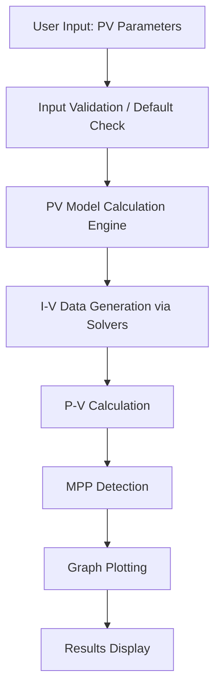

# Solar PV I-V Characteristics Graph Project

## 1. Project Title and Overview

# **Project Name:** Solar PV I-V Simulator

## *Project Overview*

The **Solar-PV-Simulator** is a Python-based software tool designed to model, simulate, and analyze the electrical performance of photovoltaic (PV) cells and modules. The project bridges physical semiconductor theory with numerical computation and visualization, enabling users to evaluate Current-Voltage ($I\text{-}V$) and Power-Voltage ($P\text{-}V$) characteristics under varying environmental and operating conditions.

### **Key Functional &amp; Architectural Highlights** 
1\. **Theoretical Modeling Foundation** 
* Built upon the **Single Diode Equivalent Circuit Model**, incorporating parameters such as light-generated current ($I_L$), diode reverse saturation current ($I_0$), series resistance ($R_s$), shunt resistance ($R_{sh}$), and diode ideality factor ($n$). 
* Integrates standard PV performance formulations, including the **De Soto Five-Parameter Model** and **PVsyst Module Model** contributed via the PV Performance Modeling Collaborative (PVPMC by NIST and Sandia National Laboratories).
* Models the complete non-linear governing single-diode equation: $$I = I_L - I_0 \left[ \exp\left( \frac{V + I R_s}{n N_s V_T} \right) - 1 \right] - \frac{V + I R_s}{R_{sh}}$$

2\. **Modular Software Architecture**

The simulator is split into small files. Each file has one job.

* **`main.py`**: The starting point. It asks the user to choose a PV module and enter irradiance and temperature. It then calls the other files in order and shows the analysis menu (curves, irradiance analysis, temperature analysis, combined analysis, change condition, exit).
* **`config.py`**: Loads the datasheet values (V_oc, I_sc, V_mp, I_mp, P_max, number of cells N_s, and the temperature coefficients for I_sc, V_oc and P_max) for the chosen module from the `pv_models.csv` catalogue. It also checks that the file is valid.
* **`pv_models.csv`**: The catalogue of PV modules. Adding a new row adds a new module, with no code changes needed.
* **`parameters.py`**: Uses the datasheet values at standard test conditions to find the hidden single-diode parameters: I_L, I_0, R_s, R_sh and the ideality factor n. It uses the Batzelis datasheet method, which relies on the Lambert W function.
* **`pv_model.py`**: The calculation engine. It adjusts the parameters to the user's irradiance and temperature, then calculates I_sc, V_oc, V_mp, I_mp and P_max for those conditions.
* **`plotter.py`**: Solves the single-diode equation for each voltage point and draws the I-V and P-V curves. It also draws the comparison plots for different irradiances, temperatures, or both together. All plots are saved as PNG images.
* **`template.py`**: Controls what is printed on screen: the simulation report, the menu, and the result tables for each analysis. It calls `plotter.py` to draw the graphs.

**How the files work together**

`main.py` → `config.py` (load module) → `parameters.py` (reference parameters) → `pv_model.py` (results for the chosen conditions) → `template.py` (print results) → `plotter.py` (draw graphs)

3\. **Numerical Solvers & Analysis**

This part of the project solves the single-diode equation and uses the results to study how a PV module behaves.

* **Solving the equation:** The single-diode equation is implicit, because the current I appears on both sides. The code finds I for each voltage point using **Brent's method** (`scipy.optimize.brentq`) in `plotter.py`. The **Lambert W function** (`scipy.special.lambertw`) is used in `parameters.py` to extract the reference parameters (I_L, I_0, R_s, R_sh, n) from the datasheet values.
* **Performance results:** For any irradiance and temperature, the simulator reports Short-Circuit Current (I_sc), Open-Circuit Voltage (V_oc), Maximum Power Voltage (V_mp), Maximum Power Current (I_mp), Maximum Power (P_max), and Fill Factor (FF).
* **Environmental effects:** The simulator studies how conditions change the output:
  * **Irradiance analysis:** several irradiance values (W/m²) at a fixed temperature of 25 °C.
  * **Temperature analysis:** several temperatures (°C) at a fixed irradiance of 1000 W/m².
  * **Combined analysis:** I-V and P-V curves for different irradiance and temperature pairs.
* **Temperature coefficients:** I_sc increases slightly with temperature, while V_oc and P_max decrease. These are applied using the coefficients stored in `pv_models.csv`.
---

## Table of Contents
1. [Project Title and Overview](#1-project-title-and-overview)
2. [Features](#2-features)
3. [Theory and Background](#3-theory-and-background)
4. [Project Working Principle](#4-project-working-principle)
5. [System Architecture](#5-system-architecture)
6. [Architecture Diagram](#6-architecture-diagram)
7. [Project Workflow / Flowchart](#7-project-workflow--flowchart)
8. [Technology Stack](#8-technology-stack)
9. [Project Folder Structure](#9-project-folder-structure)
10. [Installation and Setup](#10-installation-and-setup)
11. [How to Run the Project](#11-how-to-run-the-project)
12. [Code Explanation](#12-code-explanation)
13. [Input Parameters](#13-input-parameters)
14. [Output and Graph Explanation](#14-output-and-graph-explanation)
15. [Images and Graphs](#15-images-and-graphs)
16. [Results and Observations](#16-results-and-observations)
17. [Advantages](#17-advantages)
18. [Limitations](#18-limitations)
19. [Future Scope](#19-future-scope)
20. [Applications](#20-applications)
21. [Conclusion](#21-conclusion)
22. [References](#22-references)

---

## 2. Features

* **Module Selection:** Choose a PV module from the `pv_models.csv` catalogue. New modules can be added as new rows, with no code changes.
* **Curve Plotting:** Shows the I-V and P-V curves together on one graph, comparing the reference (datasheet) condition with your chosen irradiance and temperature.
* **Irradiance Analysis:** Sweeps several irradiance values (e.g., 200, 400, 600, 800, 1000 W/m²) at a fixed 25 °C and shows how Isc, Voc and Pmax change.
* **Temperature Analysis:** Sweeps several temperatures (e.g., 15, 25, 35, 45, 55 °C) at a fixed 1000 W/m² and shows the thermal effects.
* **Combined Analysis:** Enter a list of irradiance values and a list of temperature values. A results table shows every irradiance-temperature combination, and the I-V and P-V curves are plotted for the paired conditions.
* **Change Simulation Condition:** Return to the start and enter a new irradiance and temperature without restarting the program.
* **Parameter Calculation:** Calculates Isc, Voc, Imp, Vmp and Pmax for the chosen conditions. The Fill Factor (FF) is shown in the main simulation report.
* **Mathematical Solvers:** Solves the implicit single-diode equation using Brent's method, and uses the Lambert W function to extract the reference parameters from the datasheet.
* **Saved Plots:** Every plot is saved as a PNG image in the project folder.

---

## 3. Theory and Background
* **Solar Photovoltaic (PV) Cell:** A device represented by an equivalent circuit containing a current source, a diode, a series resistance ($R_s$), and a shunt resistance ($R_{sh}$)[cite: 6].
* **How sunlight is converted into electricity:** To be added from project documents.
* **Semiconductor PN junction basics:** To be added from project documents.
* **Photovoltaic effect:** Generates a photocurrent ($i_p$ or $I_L$) that is directly proportional to the incident solar power (insolation)[cite: 1, 5].
* **Solar cell as a current source:** The ideal PV cell acts as a current source, but practically, it has internal resistances[cite: 6].
* **I-V characteristic curve:** A graph plotting the current ($I$) against the voltage ($V$), showing a linear region and a logarithmic drop-off towards open circuit[cite: 1, 2].
* **P-V characteristic curve:** Shows the relationship between extracted power and voltage, peaking at Pmax[cite: 5, 10].
* **Open-circuit voltage ($V_{oc}$):** The maximum voltage when current $i = 0$.
* **Short-circuit current ($I_{sc}$):** The maximum current when voltage $V = 0$.
* **Maximum power point (MPP):** The operating point on the curve where the cell produces the most power, corresponding to $V_{mp}$ and $I_{mp}$.
* **Maximum power ($P_{max}$):** The power at the MPP[cite: 2, 3].
* **Voltage and current at MPP:** $V_{mp}$ and $I_{mp}$ define the area of the maximum power rectangle under the curve.
* **Fill Factor (FF):** A measure of how "good" or "bad" a PV cell is, defined as the ratio of practical power to ideal power[cite: 2]. Equation: $FF = \frac{V_{mp} \cdot I_{mp}}{V_{oc} \cdot I_{sc}}$[cite: 2].
* **Efficiency:** To be added from project documents.
* **Effect of solar irradiance on I-V curve:** Changes the $I_{sc}$ proportionally; if insolation changes, the $V_{oc}$ changes in a logarithmic manner.
* **Effect of temperature on I-V curve:** As temperature increases, $I_{sc}$ increases slightly (positive temperature coefficient, e.g., +0.045 %/K). However, $V_{oc}$ decreases significantly (negative temperature coefficient, e.g., -0.34 %/K), leading to an overall decrease in Power ($P_m$)[cite: 5, 7].
* **Series and shunt resistance:** $R_s$ limits current in the voltage source region (ideally very low), and $R_{sh}$ limits leakage (ideally very high)[cite: 1, 2]. A "bad" PV cell has very large $R_s$ and very low $R_{sh}$[cite: 2].
* **Single-diode PV model:** The standard modeling guide used to represent the cell's electrical behavior.
* **PV cell equation:** $I = I_L - I_o \left[ \exp\left(\frac{V+IR_S}{nV_T}\right) - 1 \right] - \frac{V+IR_S}{R_{sh}}$.

| Symbol | Description |
| :--- | :--- |
| $I$ | Output current[cite: 3] |
| $I_L$ / $i_p$ | Photocurrent / Light-generated current |
| $I_o$ | Diode reverse saturation current |
| $V$ | Output voltage[cite: 3] |
| $R_s$ | Series resistance[cite: 1, 3] |
| $R_{sh}$ | Shunt resistance[cite: 1, 3] |
| $n$ | Ideality factor |
| $V_T$ | Thermal voltage[cite: 1, 3] |

---

## 4. Project Working Principle
1. **User Input:** The user provides Irradiance and Temperature parameters, or the system uses default reference values.
2. **Calculate Parameters:** The system transfers reference data into actual condition parameters ($I_{L\_ref}$, $I_{o\_ref}$, etc.)[cite: 10].
3. **Current Calculation:** Because $I$ is on both sides of the PV cell equation, the system uses root-finding methods (Newton, Brent, etc.) to solve for current at different voltages.
4. **Power Calculation:** The system calculates power for the generated data points.
5. **MPP Detection:** The engine finds the Maximum Power Point (MPP).
6. **Graph Generation:** The system plots the I-V and P-V curves using NumPy and a plotter module.
7. **Results Display:** Important results such as $I_{sc}$, $V_{oc}$, $P_{max}$, and generated graphs are displayed to the user via the interface[cite: 10].

---

## 5. System Architecture
* **Input Layer:** Handles user inputs for irradiance and temperature through a loading interface or menu[cite: 10]. It relies on a `config.py` file to store constant reference values.
* **Processing Layer (Engine Brain):** The `PV_model.py` acts as the computational core. It calculates thermal voltage, photocurrent, saturation current, and output current. 
* **Visualization Layer:** The `Plotter.py` module takes the calculated arrays and generates I-V curves, P-V curves, or comparison plots.
* **Output Layer:** Displays the calculated metrics ($V_{mp}$, $I_{mp}$, $P_{max}$, FF) and the graphs back to the user[cite: 10].

---

## 6. Architecture Diagram



Block Diagram Flow:
User $\rightarrow$ Input Parameters (Irradiance, Temp) $\rightarrow$ Calculate Params $\rightarrow$ I-V/P-V Data $\rightarrow$ Graph Generator $\rightarrow$ Results[cite: 4, 9].

## 7. Project Workflow / Flowchart
```
flowchart LR
    Start([Start]) --> LoadParam[Load config / user inputs]
    LoadParam --> CalcParams[Calculate Actual Params]
    CalcParams --> GenVoltRange[Generate Voltage Range]
    GenVoltRange --> CalcCurrent[Calculate PV Current]
    CalcCurrent --> CalcPower[Calculate Power]
    CalcPower --> FindMPP[Find MPP]
    FindMPP --> PlotIV[Plot I-V curve]
    PlotIV --> PlotPV[Plot P-V curve]
    PlotPV --> Display[Display Results & UI]
    Display --> End([End])
```

## 8. Technology Stack
TechnologyDetail / Reason
Programming LanguagePython[cite: 3]Libraries UsedNumPy, pvlib   IDE or PlatformTo be added from project documents.Operating SystemTo be added from project documents.HardwareTo be added from project documents.Note: NumPy is used for array generation and graph plotting data structures[cite: 4]. pvlib-python provides standard implementations for single-diode models and solvers[cite: 3, 9].

## 9. Project Folder Structure
```
solar-iv-pv-simulator/
│
├── README.md             # Project documentation
├── requirements.txt      # Dependencies list
├── main.py               # Main execution and workflow script
├── config.py             # Stores constants, default T_ref, Voc_ref, etc.
├── PV_model.py           # Engine brain for calculations
├── Parameters.py         # Parameter handling
├── Calculations.py       # Core mathematical formulas[cite: 9]
├── Plotter.py            # Graph visualization logic[cite: 9]
├── Validator.py          # Input and data validation[cite: 9]
└── data/                 # To be added from project documents.
```

## 10. Installation and Setup
* Prerequisites: Python installed on your system.
* Required libraries: numpy, pvlib, matplotlib (placeholder for plotting based on context).Command to install * dependencies: pip install -r requirements.txt (Placeholder)Command to run the project: python main.py (Placeholder)
## 11. How to Run the Project
Clone or download the project folder.Install Python on your machine.Install required packages using the requirements command.Run the main execution file (python main.py).In the UI menu, select an option (e.g., "1. Show I-V/P-V curve" or "2. Irradiance Analysis")[cite: 10].Enter or modify PV parameters (Irradiance, Temperature) when prompted[cite: 10].View I-V and P-V graphs generated by Plotter.py[cite: 9].Interpret the printed results for $V_{oc}$, $I_{sc}$, and $P_{max}$[cite: 10].
## 12. Code Explanation
config.pyPurpose: Stores reference constants[cite: 9].Important Variables: q, K, Ns, Voc_ref, Isc_ref, Rs, Rsh, n, G_ref, default T_ref[cite: 9].PV_model.pyPurpose: Acts as the "Engine Brain" of the simulation[cite: 9].Main Logic / Functions: calculate_thermal_voltage(), calculate_photocurrent(), calculate_saturation_current(), calculate_current(), generate_iv_curve(), calculate_Power(), find_MPP()[cite: 9].Equations Used: Implements implicit methods like Newton, Brent, Chandrupatla, Lambert W, or Bishop-type methods to solve for $I$[cite: 9].Plotter.pyPurpose: Handles all graph generation[cite: 9].Main Logic / Functions: Plot_IV_curve(), Plot_PV_curve(), Plot_comparison()[cite: 9].main.pyPurpose: Controls the application flow[cite: 9].Main Logic: get_input $\rightarrow$ calculate parameters $\rightarrow$ generate curve $\rightarrow$ calculate MPP $\rightarrow$ Plot results $\rightarrow$ display results[cite: 9].
>>>>>>> 7d1db8b (README.md)
